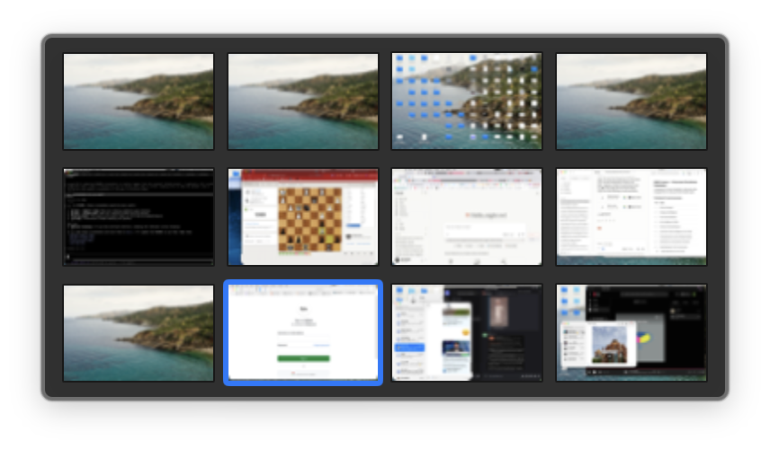
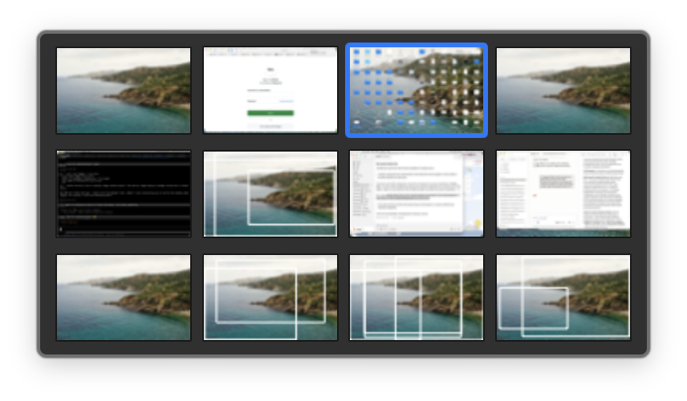
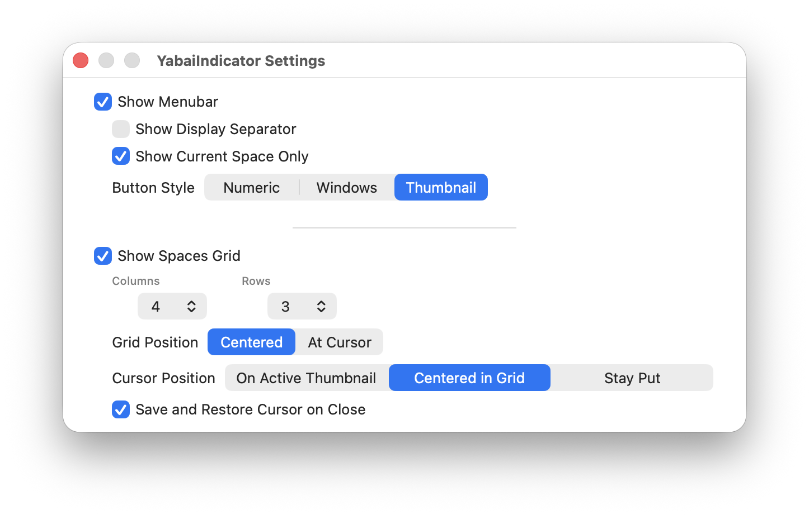

<div align="center">


# YabaiSpaces

**Clickable spaces switcher powered by Yabai**



Floating panel with window previews and keyboard navigation



Wireframe window outlines for unvisited spaces



Customizable panel layout and display options

</div>

## Current version: 1.10.0

This README describes the current source and locally installed `/Applications/YabaiSpaces.app`, including the existing keyboard setup checked on October 6, 2026. Published release DMGs may lag these changes; check the installed version and `--help` rather than assuming an older download supports every command below.

The [universal 1.10.0 DMG](YabaiSpaces-1.10.0-Universal.dmg) includes fresh departure-time thumbnails and Space-only thumbnail clicks. Its exact app is installed locally. Verify the [SHA-256 checksum](YabaiSpaces-1.10.0-Universal.dmg.sha256) and read the [1.10.0 release notes](docs/RELEASE_1.10.0.md). Use [GitHub Releases](https://github.com/carcot/YabaiSpaces/releases) for published downloads and check the release's actual version, not just this README's heading. The retained 1.8.0 DMG is historical and predates these fixes.

**Published:** [YabaiSpaces 1.10.0](https://github.com/carcot/YabaiSpaces/releases/tag/v1.10.0) — [download universal DMG](https://github.com/carcot/YabaiSpaces/releases/download/v1.10.0/YabaiSpaces-1.10.0-Universal.dmg) and [checksum](https://github.com/carcot/YabaiSpaces/releases/download/v1.10.0/YabaiSpaces-1.10.0-Universal.dmg.sha256). Both published assets were downloaded again and byte-compared with the verified local files.

**Distribution warning:** the current local app and 1.10.0 package are **Apple Development signed, not Developer ID signed/notarized for public distribution**. Launching successfully on the development Mac does not establish Gatekeeper acceptance elsewhere. See [installation and Gatekeeper guidance](docs/INSTALLATION.md#signing-and-gatekeeper) before installing a downloaded build.

## Features

- **Spaces panel**: Clickable Spaces, arrow-key navigation, real thumbnails, and wallpaper/window-outline fallbacks for uncaptured desktops.
- **Window-history navigation**: Cycle windows or applications within/across Spaces; recent-Space navigation restores the most recently focused eligible window in each Space.
- **Caps-tap application jumps**: A two-second prefix with editable application/Space bindings, handled natively by YS.
- **Focus tracking**: ID-bearing yabai events, bounded raw history, live reconciliation, and native diagnostics.
- **Thinning focus border**: An orange border shrinks from three points to zero during the renewable two-second cycle, keeping its inner edge against the window.
- **Manual window controls**: Control–Option drag to move/resize, with optional insertion beside a tile on a yabai-managed BSP Space.
- **Native automation**: skhd and other tools call the installed executable directly; no Python helper or Hammerspoon navigation handler is needed for the migrated actions.
- **Display customization**: Numeric/window/thumbnail menu-bar styles, panel position, cursor behavior, and grids from 1–12 columns/rows.

## Keyboard setup and skhd

The following describes this machine's configured shortcuts, not mappings automatically installed by YS on every Mac.

| Input | Action | Routing |
| --- | --- | --- |
| Right-Shift tap | Show the Spaces panel; if already visible, activate the selected Space | Karabiner emits F18 → skhd → YS |
| Command–Option–Control–Shift–Space (Hyper-Space) | Toggle the Spaces panel | YS's built-in hotkey; the existing BetterTouchTool gesture also emits this chord |
| Right-Command tap | Cycle recent Spaces, restoring each Space's latest eligible window | Karabiner emits Command-F19 → skhd → YS |
| Right-Option tap | Cycle individual windows in the current Space | Karabiner emits Option-F19 → skhd → YS |
| Command-period | Cycle recent Spaces | skhd → YS |
| Caps tap, then a configured letter | Jump to the latest eligible matching application/window | Karabiner emits unmodified F20 → YS directly |
| Left-Command tap | No YS action; normal Command behavior remains | Its former Karabiner tap rule was removed |
| Command-L | Normal shortcut in the focused application | The global skhd binding was removed |

Active YS rules in `~/.config/skhd/skhdrc`:

```text
f18 : /Applications/YabaiSpaces.app/Contents/MacOS/YabaiIndicator panel activate-selected-or-show
alt - f19 : /Applications/YabaiSpaces.app/Contents/MacOS/YabaiIndicator window next-in-space
cmd - f19 : /Applications/YabaiSpaces.app/Contents/MacOS/YabaiIndicator space next-recent
cmd - 0x2F : /Applications/YabaiSpaces.app/Contents/MacOS/YabaiIndicator space next-recent
```

`0x2F` is period. Do not add a global Command-L rule or an F20 skhd rule: Command-L is deliberately released, and YS consumes F20 synchronously at its event tap before the following letter can arrive. Ordinary Command holding/chords are unaffected by removing the Left-Command tap action.

### Who handles what?

- **YS** owns panel behavior, prefix timing/key consumption, application/window selection, window MRU, cycling, borders, and manual window controls.
- **skhd** dispatches the four high-level shortcuts above. The installed daemon is `skhd.zig v0.2.0-7e95d99`; it uses the ordinary event-tap route, not a newly enabled keyboard grabber.
- **Karabiner** still recognizes physical tap versus hold and preserves application-specific remapping. Caps holds remain Right Control in configured terminals/Screen Sharing and Left Command under the general rule. Emacs/Portacle remain excluded from those Caps rules. Terminal-specific Tab tap/Control hold and the remaining remaps are preserved.
- **Hammerspoon** is no longer responsible for the migrated YS prefix/navigation actions. Unrelated Hammerspoon automation is not removed.
- **yabai** supplies windows, Spaces, focus events, and move/resize/BSP layout operations. YS does not maintain a competing tiling tree.

Reliance on Karabiner is minimized only where behavior is preserved. A skhd-only tap/hold handoff remains deferred; it was not implemented by rewriting skhd, downgrading the shared driver, or running competing grabbers. Application-specific hotkey dispatch is not the same as application-specific tap/hold remapping. See the dated [grabber compatibility research](docs/SKHD_GRABBER_RESEARCH.md) and [shortcut migration/rollback](docs/SHORTCUT_MIGRATION.md).

## Caps-tap application and Space bindings

Tap Caps, then an unmodified mapped key within **two seconds**. Another Caps tap renews the prefix. During the prefix, selection keys are consumed rather than typed into the application. Escape, period, or an unconfigured letter dismisses it without navigation. Caps-period does **not** cycle windows. After timeout, keys resume normal application behavior; modified chords and other unrecognized keys do not select an application.

YS selects the most recently focused eligible matching window. It does not launch missing applications, unhide/minimize windows, or move them into the requested Space. A Space condition means a yabai Space index, not a window number. A jump ends any active cycling session. Physical Caps tap availability still follows the Karabiner application conditions above.

Bindings are in `~/.config/yabaispaces/config.toml`. Keep app and optional Space together:

```toml
[caps]
g = { app = "Ghostty" }
c = { app = "Brave Browser", space = 6 }
b = { app = "Brave Browser", space = 7 }
h = { app = "Brave Browser", space = 8 }
w = { app = "Word", match = "contains" }
q = { disabled = true }
```

The file is the **complete letter mapping**, not an overlay: using only the example above disables the other letters. Matching is case-sensitive; `exact` is the default and `contains` enables substring matching. An omitted/disabled letter dismisses the prefix.

### Currently configured letters on this machine

| Key | Application | Space restriction | Match |
| --- | --- | --- | --- |
| A, W | Word | Any | Contains |
| B | Brave Browser | 7 | Exact |
| C | Brave Browser | 6 | Exact |
| D | Discord | Any | Contains |
| F | Firefox | Any | Contains |
| G | Ghostty | Any | Exact |
| H | Brave Browser | 8 | Exact |
| J | iTerm2 | Any | Contains |
| K | kitty | Any | Contains |
| L | Logseq | Any | Contains |
| M | Messages | Any | Contains |
| N | Signal | Any | Contains |
| P | PowerPoint | Any | Contains |
| R | Friendly Streaming | Any | Contains |
| S | Safari | Any | Contains |
| V | Code | Any | Contains |
| X | Excel | Any | Contains |
| Y | Spotify | Any | Contains |
| Z | zoom.us | Any | Contains |
| E, I, O, Q, T, U | No binding; dismiss | — | — |

The local G → Ghostty entry overrides the generated/built-in G → GoodNotes default; it is not a universal installation default. Numbers have built-in, non-TOML-configurable jumps: `1`–`9` → Spaces 1–9, `0` → 10, `-` → 11, `=` → 12.

Use **YS menu → Edit Caps bindings…**, save, then **Reload Caps bindings**, or:

```sh
/Applications/YabaiSpaces.app/Contents/MacOS/YabaiIndicator config reload
```

Reload is explicit, not automatic. A valid file atomically replaces the bindings without rebuilding/restarting YS; an invalid reload retains the current mapping. Startup creates the file only if absent; an invalid startup file falls back to built-in defaults. Other settings use macOS preferences rather than this TOML file. See [configuration and prefix details](docs/CAPS_PREFIX.md).

## Window history, cycling, and border

Recent-Space order is derived from **window** MRU: retain the most recent eligible window for each Space, then cycle those representatives with wraparound. It is not a separate Space history and not simply the window list. Duplicate windows in one Space cannot trap traversal; empty Spaces do not participate. Eligible targets are standard, non-hidden, non-minimized windows with valid IDs/Spaces; dialogs and YS's own windows are excluded.

Repeated navigation freezes candidates and renews a **two-second** deadline for each processed cycling command. Verified YS-generated focus retains that traversal. A confirmed external focus change, panel selection, application jump, failure, or expiry ends the cycle and updates normal history. Manual focus updates do not wait for the timer. Restarting YS resets its learned history; it is not imported from Hammerspoon or persisted across restarts.

During cycling, the orange border thins linearly from up to three points to zero. Its inner edge stays flush against the window as it follows movement; showing/hiding and frame updates have no added animation. Cycling again renews its thickness/deadline. The overlay cannot activate or intercept clicks, is hidden while the Spaces panel is visible, and is excluded from departure thumbnails. Caps-prefix waiting and ordinary app jumps do not show this border.

YS receives the actual window ID from each yabai focus event, retaining a bounded raw journal separately from navigation eligibility. Blocking queries/verification run on workers rather than the intake/state queue. Live inventory reconciliation runs every second; YS checks its owned signal registrations every 30 seconds. These intervals are separate from the two-second prefix/cycling policies.

```sh
/Applications/YabaiSpaces.app/Contents/MacOS/YabaiIndicator focus status
```

Diagnostics include the latest 32 raw records, current focus, window MRU, and health/gap/retention counters. The raw ring and pending intake are each bounded to 1,024 entries. Signal handlers can arrive out of order: receipt order is best effort, and snapshots repair current focus rather than reconstruct missing intermediate history. For example, Ghostty has been observed foreground while yabai reports no key window; YS leaves confirmed focus unknown rather than inventing an event. See [switching semantics](docs/WINDOW_SWITCHING.md) and [focus tracking, tests, and limitations](docs/FOCUS_TRACKING.md).

## Manual window controls and optional tiling

- Hold **Control–Option** and left-drag inside a window to move it, or right-drag to resize from its bottom-right corner.
- A blue preview shows the proposed placement. Changes apply **on release**, not continuously during dragging. Escape cancels; movement below five points does nothing.
- On an explicitly BSP-tiled Space, drop onto another eligible tile to insert beside its nearest edge. Tiled right-drag adjusts bottom/right tree boundaries; outer boundaries may not resize.
- **YS menu → Window controls** enables/disables mouse controls and exposes tiling, floating, and split actions. Disabling mouse controls persists; native command actions remain available.

Tiling is **opt-in** and owned by yabai. **Tile current Space (automatic BSP)** enables real automatic management on that Space; do not use it if you want a completely manual floating layout. **Stop tiling current Space** does not restore earlier floating positions. Installation does not automatically tile existing Spaces.

YS adapts HyprMac's nearest-target-edge selection, not its independent layout engine. This is insertion beside a window edge, not screen-edge snapping. Cross-Space insertion, live animated dragging, layout restoration, and a separate YS tiling tree are not implemented. Free-window commands move/resize by 40 points; no new keyboard bindings for these commands are installed. See [controls, safety, and HyprMac reuse](docs/WINDOW_HANDLING.md).

## Native commands

Call the installed executable directly to send commands to the running app:

```sh
/Applications/YabaiSpaces.app/Contents/MacOS/YabaiIndicator panel toggle
/Applications/YabaiSpaces.app/Contents/MacOS/YabaiIndicator panel activate-selected-or-show
/Applications/YabaiSpaces.app/Contents/MacOS/YabaiIndicator space next-recent
/Applications/YabaiSpaces.app/Contents/MacOS/YabaiIndicator window next-in-space
/Applications/YabaiSpaces.app/Contents/MacOS/YabaiIndicator app next-across-spaces
/Applications/YabaiSpaces.app/Contents/MacOS/YabaiIndicator jump g
/Applications/YabaiSpaces.app/Contents/MacOS/YabaiIndicator window wider
/Applications/YabaiSpaces.app/Contents/MacOS/YabaiIndicator handling off
/Applications/YabaiSpaces.app/Contents/MacOS/YabaiIndicator focus status
/Applications/YabaiSpaces.app/Contents/MacOS/YabaiIndicator --help
```

Command families:

| Family | Actions |
| --- | --- |
| `panel` | `show`, `hide`, `toggle`, `activate-selected`, `activate-selected-or-show` |
| `app` / `window` navigation | `next-in-space`, `previous-in-space`, `next-across-spaces`, `previous-across-spaces` |
| `space` | `next-recent`, `tile`, `untile` |
| `window` controls | `move-left`, `move-right`, `move-up`, `move-down`, `wider`, `narrower`, `taller`, `shorter`, `toggle-float`, `toggle-split` |
| `handling` | `on`, `off` |
| `prefix` | `start`, `cancel` (automation; physical Caps uses direct F20) |
| `jump` | Configured letters or built-in Space keys |
| `config` | `reload` |
| `event` | `window-focused <id>`, `window-destroyed <id>`, `reconcile` (internal yabai automation) |
| `focus` | `status` (JSON diagnostics) |

On this machine, `/opt/homebrew/bin/YabaiSpaces` is a direct symlink to the executable, allowing `YabaiSpaces focus status`; that symlink is not assumed on other installations. No arguments starts the GUI. Commands do not start another GUI or auto-launch a missing server. Use shell actions, not `open -a ... --args`, for dispatch.

Exit 0 usually means work was queued, not that focus/movement completed. Exceptions: configuration reload confirms installation of the mapping, and status returns diagnostics. Exit 1 indicates transport/server failure; exit 2 is invalid usage. Event acknowledgment means bounded in-memory intake, not durable recording. Do not automatically retry an ambiguous timeout. YS uses the same-user `/tmp/yabai-indicator.socket`; neither Python nor Hammerspoon is required in this route. See [protocol, deadlines, and failure handling](docs/NATIVE_COMMANDS.md).

## Thumbnail Capture

YabaiSpaces captures visible desktops before opening the panel for the initial preview. When you choose a destination, it hides the panel and captures the outgoing desktop again, synchronously **immediately before leaving**, rather than retaining the earlier opening snapshot. Capture explicitly excludes YS window IDs so a panel waiting for the display compositor to disappear cannot enter the image. Reopening/repositioning an already-visible panel does not capture it. YS switches without the panel (including recent-Space and cross-Space window/application commands) also capture immediately before departure. Spaces without a captured thumbnail show wallpaper plus window outlines.

External switches that bypass YS, such as Mission Control gestures or direct yabai commands, still do not trigger a pre-departure capture. Visible panel previews are not a live video feed, but the saved outgoing thumbnail is refreshed at departure. A failed clean capture preserves the last cached image instead of using a panel-contaminated fallback. See [capture timing and verification](EXTERNAL_SWITCH_CAPTURE_NOTES.md).

## Requirements and installation

- macOS with a running [yabai](https://github.com/asmvik/yabai) daemon. The tested baseline is yabai **7.1.25**, Apple Silicon, macOS **26.6.2**, with **SIP enabled**; this is not a guarantee for every macOS release or Intel Mac.
- Accessibility/input-monitoring authorization as required for yabai, YS event taps/window controls, and your shortcut tools; Screen Recording authorization for real desktop thumbnails. Each tool needs its own applicable permissions.
- skhd/Karabiner are needed for this machine's physical tap mappings, not for basic menu/panel use or direct native commands.
- Xcode and the project's Swift packages for source builds only; neither Xcode nor Python is required to run a downloaded app.

### Fresh installation

1. Install yabai using [its upstream instructions](https://github.com/asmvik/yabai/wiki/Installing-yabai-(latest-release)). With Homebrew, install and start it:

   ```sh
   brew install asmvik/formulae/yabai
   yabai --start-service
   ```

   Grant **yabai** Accessibility access and confirm `yabai -m query --spaces` succeeds. Preserve existing `~/.yabairc` settings; no scripting addition or SIP change is needed just for YS's basic navigation.
2. Download an actually published DMG and its checksum from [Releases](https://github.com/carcot/YabaiSpaces/releases). Verify the checksum, open the DMG, and drag **YabaiSpaces.app** to **Applications**. For upgrades, quit YS and preserve a verified backup before cleanly replacing the old bundle, rather than merging bundles.
3. Launch **`/Applications/YabaiSpaces.app`**. Grant YS the applicable **Accessibility/Input Monitoring** access for input handling and **Screen Recording** (called **Screen & System Audio Recording** on newer macOS) for screenshots. Restart the affected app if macOS requests it. Follow the signing warning above if Gatekeeper blocks first launch; do not disable system protections.
4. For actual screenshots, open **Preferences → Button Style → Thumbnail**. The default **Windows** mode shows wallpaper/window outlines, not screenshots. This style setting is shared by the menu bar and panel. Open the panel once for an initial capture; later YS departures refresh the outgoing image immediately before switching.
5. Optionally configure the [skhd/Karabiner shortcuts](#keyboard-setup-and-skhd). YS does not install this machine's personal mappings for you. Basic menu/panel use and Hyper-Space work without those mappings.

The [installation guide](docs/INSTALLATION.md) covers permission ownership, checksums, upgrades/rollback, outline fallbacks, and troubleshooting. Avoid stale repository app bundles and permanent launches from temporary build directories; never run two GUI copies sharing the same socket.

### SIP-enabled switching and no-animation support

**You do not need to disable SIP just to obtain fast Space switching with current yabai.** Since **7.1.19**, `yabai -m space --focus` works with SIP enabled, using a gesture-based route that bypasses the normal visible slide rather than requiring the Dock scripting addition. See the [upstream implementation discussion](https://github.com/asmvik/yabai/issues/2780). This is not a promise of zero input latency or control over every Mission Control gesture.

For switches caused by focusing an application/window on another Space (such as Command-Tab or Dock selection), **7.1.22** added `skip_window_focus_animation`, improved in **7.1.23**. See [yabai's version history](https://github.com/asmvik/yabai/blob/v7.1.25/CHANGELOG.md). **Only if you are not using the scripting addition**, apply this optional setting and add the same line to your existing `~/.yabairc` for future startups:

```sh
yabai -m config skip_window_focus_animation on
```

The [manual](https://github.com/asmvik/yabai/blob/v7.1.25/doc/yabai.asciidoc) says not to enable it alongside the scripting addition, which already handles that case. `window_animation_duration 0` controls **window move/resize frame animation**, not Space transitions. Moving windows between Spaces works with SIP enabled again in **7.1.25**; creating/reordering Spaces and other scripting-addition features still have separate [SIP requirements](https://github.com/asmvik/yabai/wiki/Disabling-System-Integrity-Protection).

Local read-only verification on October 22, 2026 found SIP **enabled**, `skip_window_focus_animation` **off**, and `window_animation_duration` **0.0**. The optional setting above has not been applied by this documentation update. Private-API/macOS compatibility remains version-dependent.

### Yabai signals

Existing panel/window refresh actions in `~/.yabairc` remain useful:

```sh
yabai -m signal --add event=mission_control_exit action='echo "refresh" | nc -U /tmp/yabai-indicator.socket'
yabai -m signal --add event=display_added action='echo "refresh" | nc -U /tmp/yabai-indicator.socket'
yabai -m signal --add event=display_removed action='echo "refresh" | nc -U /tmp/yabai-indicator.socket'
yabai -m signal --add event=window_created action='echo "refresh windows" | nc -U /tmp/yabai-indicator.socket'
yabai -m signal --add event=window_destroyed action='echo "refresh windows" | nc -U /tmp/yabai-indicator.socket'
yabai -m signal --add event=window_moved action='echo "refresh windows" | nc -U /tmp/yabai-indicator.socket'
yabai -m signal --add event=window_resized action='echo "refresh windows" | nc -U /tmp/yabai-indicator.socket'
yabai -m signal --add event=window_minimized action='echo "refresh windows" | nc -U /tmp/yabai-indicator.socket'
yabai -m signal --add event=window_deminimized action='echo "refresh windows" | nc -U /tmp/yabai-indicator.socket'
```

YS 1.8.0 and later install and verify these labeled tracking actions after the socket starts; they are also recorded in this machine's persistent `.yabairc`:

```sh
yabai -m signal --add label=ys-focus-window event=window_focused action='/Applications/YabaiSpaces.app/Contents/MacOS/YabaiIndicator event window-focused "$YABAI_WINDOW_ID"'
yabai -m signal --add label=ys-focus-destroyed event=window_destroyed action='/Applications/YabaiSpaces.app/Contents/MacOS/YabaiIndicator event window-destroyed "$YABAI_WINDOW_ID"'
yabai -m signal --add label=ys-focus-front event=application_front_switched action='/Applications/YabaiSpaces.app/Contents/MacOS/YabaiIndicator event reconcile'
yabai -m signal --add label=ys-focus-space event=space_changed action='/Applications/YabaiSpaces.app/Contents/MacOS/YabaiIndicator event reconcile'
yabai -m signal --add label=ys-focus-wake event=system_woke action='/Applications/YabaiSpaces.app/Contents/MacOS/YabaiIndicator event reconcile'
```

Reusing YS's labels is idempotent; repeatedly sourcing the old **unlabeled** refresh actions can create duplicates. Back up configuration and active signals before migration. Replace only the identified old YS `window_focused` refresh action; retain other consumers. Older YS apps reject the new event protocol, so restore affected signals/configuration before rolling back the app. Do not broadly remove all yabai signals.

If external keybindings change Space arrangements, request a panel/data refresh:

```sh
echo "refresh" | nc -U /tmp/yabai-indicator.socket
```

## Settings and panel navigation

Open **Preferences** from the menu-bar/context menu or by right-clicking the panel.

**Menu-bar options:** Show/Hide Menu Bar, Show Display Separator, Show Current Space Only, and Numeric/Windows/Thumbnail button styles.

**Button Style is shared by the menu bar and panel:** **Numeric** shows labels, **Windows** (the default) shows wallpaper/window outlines, and **Thumbnail** shows cached desktop screenshots where available. Windows mode never displays the screenshot cache; seeing only wallpaper there is not a stale-thumbnail bug. In Thumbnail mode, uncaptured Spaces still fall back to outlines. Captures are in memory, reset on restart, and are not a live feed. YS-controlled departures refresh them just before leaving; external switches do not have that hook. See [first-run previews](docs/INSTALLATION.md#choose-real-thumbnails).

**Panel options:** Show/Hide Spaces Grid; centered/at-cursor placement; cursor on active thumbnail/centered/stay-put; cursor restoration; 1–12 columns/rows.

When the panel is visible:
- **Arrow keys** move between Spaces with wraparound.
- **Enter/Space** activates the selected Space.
- **Escape** closes without selecting.
- **Click** anywhere on a thumbnail activates its Space, without choosing a window based on click position; **right-click** opens the context menu. The former hit-testing code is retained in comments, not active.
- **Scroll/swipe** closes the panel.
- A **Right-Shift tap** confirms selection through skhd rather than merely toggling the panel closed.

The menu also exposes **Window controls**, **Edit Caps bindings…**, and **Reload Caps bindings**.

## Changes leading to 1.10.0

| Version/update | Changes |
| --- | --- |
| 1.10.0 | Thumbnail clicks only switch Spaces; old coordinate-based window selection and drag handler are commented out and retained |
| 1.9.0 | Fresh outgoing capture after panel dismissal, immediately before departure; explicit YS-window exclusion and a real-pixel timing regression |
| 1.8.0 | ID-bearing focus/destroy signals, bounded diagnostics, asynchronous intake/query/navigation workers, live reconciliation, registration repair, and explicit ordering/source limitations |
| 1.7.0 | Border thins to timeout with its inner edge always adjacent to the window |
| 1.6.0 | Manual-focus cycling/history correction, automatic expiry, temporary border, Caps-period removal, and release of global Command-L |
| 1.5.0 | Caps prefix shortened from three seconds to two |
| 1.4.0 | Editable TOML app/Space bindings and fail-safe explicit reload |
| 1.3.0 | Manual move/resize previews, nearest-tile-edge insertion, optional yabai BSP controls, and bundled HyprMac license |
| 1.2.1 | Direct startup F20 event-tap handling, eliminating the helper/skhd prefix-start race |
| 1.2.0 | Native Caps-letter selection replacing the migrated Hammerspoon prefix |
| Other source/configuration updates | Native panel/skhd dispatch replacing Python helpers; window-MRU-derived deduplicated recent Spaces; panel selection ending cycles; clean pre-departure thumbnails; Left-Command tap disabled; local G binding changed to Ghostty |

Detailed root causes, historical deployments, and verification are in [SESSION_LOG.md](SESSION_LOG.md). Historical mapping tables in the migration documents describe their dates; the active shortcut table above supersedes old Command-L/either-Command descriptions.

## Development and verification

The packaged **1.10.0** build passed **53 tests with no skips in 85.362 seconds**, including a guard that thumbnail clicks only switch Spaces and the old hit-testing code remains commented out. A clean signed universal Release build was installed with verified backup/signature/contents, then restarted and checked through native command handling and two actual panel open/close cycles. The mounted DMG matched the build; its signature, version, both architectures, Applications shortcut, and checksum were verified. Physical click/Space-selection and multi-display verification remain separate.

The earlier **1.9.0** fix passed **52 tests**, including eight real-pixel departure checks with changed desktop content and a contrasting panel, plus checked filtering of invalid/oversized AppKit window numbers. These capture regressions remain in the 1.10.0 suite; departure timing is unchanged.

The 1.8.0 runtime release passed **45 tests**, an explicit clean signed Xcode build, verified backup/install/restart, and coordinated live focus/history/cycling/expiry checks with original foreground restoration. This does not establish every physical keyboard, mouse-drag, dialog, or multi-monitor scenario; see the feature documents for coverage and limits.

The earlier 1.8.0 packaging added five tests, for 50 at that version. Its [universal 1.8.0 DMG](YabaiSpaces-1.8.0-Universal.dmg) contains `YabaiSpaces.app` and an Applications shortcut; verify it with the [SHA-256 checksum](YabaiSpaces-1.8.0-Universal.dmg.sha256). See [1.8.0 release notes](docs/RELEASE_1.8.0.md) for that package's changes and distribution limits; it does not include the 1.9.0 fix.

```sh
python3 -m unittest test_caps_configuration test_native_commands test_panel_commands test_window_switching test_caps_prefix test_window_handling test_thumbnail_capture test_merge_regressions test_run test_cycling_border test_focus_tracking test_build_dmg
```

Configuration tests resolve the pinned TOMLDecoder package, or accept `YS_TOMLDECODER_SOURCE` pointing to a resolved checkout for offline runs.

`./build-dmg.sh` performs an isolated **clean Release build** for arm64 and x86_64, derives the filename from the built app's version, verifies its signature and both architectures, packages the branded app, and verifies the DMG. It retains the build directory/full log and fails rather than packaging stale output if compilation or verification fails. It does not install or restart YS.

`./run.sh --build-only` creates and verifies an isolated signed build but **does not install, stop, or restart the daily app**. For an explicit clean build:

```sh
BUILD_DIR="$(mktemp -d /tmp/YabaiSpaces-build.XXXXXX)"
xcodebuild -project YabaiIndicator.xcodeproj -scheme YabaiIndicator -configuration Debug -derivedDataPath "$BUILD_DIR" clean build
```

After runtime changes: test, preserve/verify the installed-app backup, verify the replacement's strict signature and matching designated requirement, stop the old process, install and compare bundle contents, then restart `/Applications/YabaiSpaces.app` and verify process/command behavior. A successful uninstalled build is not completion. Increment the minor version for published runtime changes, at least before pushing. Documentation-only changes do not require an app rebuild/restart or version bump. See [safe development and rollback](docs/SAFE_DEVELOPMENT.md).

## Remaining limitations and future work

- Fully user-configurable panel hotkeys and a visual grid editor.
- Full-screen-app distinctions and further multi-monitor validation.
- Exact chronological focus reconstruction or persistent history across restarts.
- A compatible, behavior-preserving skhd tap/hold replacement for the remaining Karabiner rules; no upstream schedule is assumed.
- Screen-edge snapping, cross-Space tile insertion, layout restoration, and live animated move/resize.

## Comparison to Similar Applications

[YabaiIndicator](https://github.com/xiamaz/YabaiIndicator) by Max Zhao - Excellent app with reliable space detection, Yabai integration, and space switching. It serves as the foundation for this project. Huge thanks to Max for his great idea and creating such a solid base for this project.

[SpaceId](https://github.com/dshnkao/SpaceId) - More presentation configurability but no space switching. Doesn't use Yabai or Accessibility API.

[WhichSpace](https://github.com/gechr/WhichSpace) - Shows only the current active space. No all-spaces view or multi-display support.

## License

Based on [YabaiIndicator](https://github.com/xiamaz/YabaiIndicator) by Max Zhao.
